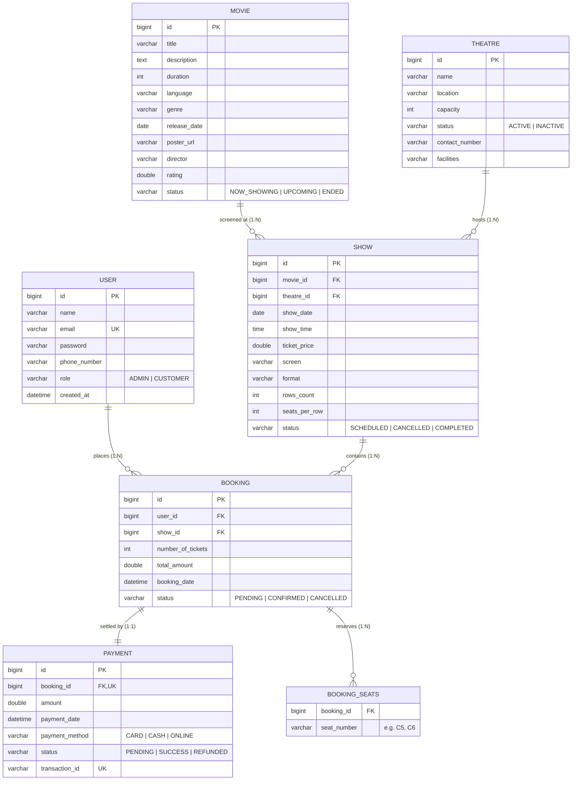

# Online Movie Ticket Booking System - Backend

> **Coursework Specification**: CMJD 114/115 — Movie Ticket Booking System  
> **Institute**: IJSE (Institute of Java and Software Engineering)  
> **Module**: Backend Development with Spring Boot and MySQL  
> **Architecture**: Layered Architecture (Controller → Service → Repository → MySQL)  

---

## 1. Executive Summary & Objective

The **Online Movie Ticket Booking System** backend is an enterprise-grade RESTful API built on **Spring Boot 3** and **MySQL**. It powers a multi-theatre cinematic ticketing platform, enabling customers to discover movies, browse screening schedules, check real-time seat availability, reserve tickets without seat collisions, and complete payments. Administrators are equipped with full control to manage users, movies, theatres, screening shows, bookings, and financial transaction records.

---

## 2. Technology Stack

| Layer / Aspect | Technology | Version / Specification |
|---|---|---|
| **Language** | Java | OpenJDK 21 / 23 (Bytecode release 21) |
| **Framework** | Spring Boot | 3.3.5 |
| **Data Persistence** | Spring Data JPA / Hibernate | 6.5.x |
| **Security & Auth** | Spring Security 6 + JJWT | JJWT 0.12.6 (HMAC-SHA384) |
| **Relational Database**| MySQL Community Server | 8.0+ |
| **Build & Dependency** | Apache Maven | 3.9+ |
| **Validation** | Jakarta Bean Validation | Hibernate Validator |
| **Documentation & ERD**| Mermaid.js / Markdown | GitHub Flavored |

---

## 3. Layered Architectural Design

The codebase strictly adheres to the standard enterprise **Layered Architecture pattern**, ensuring strict separation of concerns, high maintainability, and clean dependency inversion:

```
┌─────────────────────────────────────────────────────────────┐
│                    Presentation Layer                       │
│     (REST Controllers: Auth, Movie, Theatre, Show, etc.)    │
└──────────────────────────────┬──────────────────────────────┘
                               │ Request / Response DTOs
                               ▼
┌─────────────────────────────────────────────────────────────┐
│                      Business Layer                         │
│     (Service Interfaces & Implementations: @Transactional)  │
└──────────────────────────────┬──────────────────────────────┘
                               │ Domain Entities
                               ▼
┌─────────────────────────────────────────────────────────────┐
│                    Persistence Layer                        │
│          (Spring Data JPA Repositories & JPQL Queries)      │
└──────────────────────────────┬──────────────────────────────┘
                               │ JDBC / HikariCP Pool
                               ▼
┌─────────────────────────────────────────────────────────────┐
│                    Database Layer (MySQL)                   │
│          (Tables: users, movies, theatres, shows, etc.)     │
└─────────────────────────────────────────────────────────────┘
```

- **Controller Layer** (`com.cinebook.moviebooking.controller`): Handles HTTP routing, input validation (`@Valid`), and maps responses into standardized `ApiResponse<T>` envelopes.
- **Service Layer** (`com.cinebook.moviebooking.service`, `.service.impl`): Enforces transactional integrity (`@Transactional`), business validation rules, seat collision avoidance, and entity-DTO transformation.
- **Repository Layer** (`com.cinebook.moviebooking.repository`): Extends `JpaRepository<T, ID>` with custom JPQL queries for search filtering, scheduling conflict validation, and booked seat retrieval.
- **Security & JWT Layer** (`com.cinebook.moviebooking.security`, `.config`): Intercepts requests through `AuthTokenFilter`, decodes JWT tokens, injects `CustomUserDetails` into `SecurityContextHolder`, and enforces role-based URL protection.
- **Exception Layer** (`com.cinebook.moviebooking.exception`): `@RestControllerAdvice` (`GlobalExceptionHandler`) intercepts `MethodArgumentNotValidException`, `ResourceNotFoundException`, `ConflictException`, and `UnauthorizedException` returning structured error payloads.

---

## 4. Entity-Relationship Model (ERD)

The domain model consists of **6 core entities** and their relational constraints:



### Relational Schema Summary

| Table | Primary Key | Foreign Keys | Key Constraints |
|---|---|---|---|
| `users` | `id` (AUTO_INCREMENT) | None | `email` (UNIQUE, NOT NULL) |
| `movies` | `id` (AUTO_INCREMENT) | None | `title`, `duration`, `release_date` (NOT NULL) |
| `theatres` | `id` (AUTO_INCREMENT) | None | `name`, `location`, `capacity` (NOT NULL) |
| `shows` | `id` (AUTO_INCREMENT) | `movie_id` → `movies(id)`, `theatre_id` → `theatres(id)` | Conflict check: (theatre, screen, date, time) |
| `bookings` | `id` (AUTO_INCREMENT) | `user_id` → `users(id)`, `show_id` → `shows(id)` | `total_amount`, `booking_date` (NOT NULL) |
| `booking_seats`| Composite (`booking_id`, `seat_number`) | `booking_id` → `bookings(id)` | Prevents duplicate seat numbers per booking |
| `payments` | `id` (AUTO_INCREMENT) | `booking_id` → `bookings(id)` | `booking_id` (UNIQUE), `transaction_id` (UNIQUE) |

---

## 5. Business Rules & Validation Logic

1. **Role-Based Authority Enforcement**:
   - **`ADMIN`**: Exclusive privilege to create, update, and delete Movies, Theatres, and Shows; full access to view all users, bookings, and payment records.
   - **`CUSTOMER`**: Can browse public movies/theatres/shows, view seat maps, book tickets, process payments, view own booking history, and cancel own bookings.
2. **Show Scheduling Guardrails**:
   - Shows **cannot** be scheduled in `INACTIVE` theatres.
   - Shows **cannot** be scheduled for movies marked with status `ENDED`.
   - **Conflicting showtimes disallowed**: Scheduling two active shows in the same theatre on the same screen at the same date and time throws `409 ConflictException`.
3. **Seat Collision Avoidance**:
   - When a booking request is submitted, all active (`!= CANCELLED`) seat reservations for that show are queried (`findBookedSeatsByShowId`).
   - If any requested seat is already booked, the system rejects the transaction with a `409 ConflictException` listing the colliding seat numbers.
4. **Booking Lifecycle & Payment Confirmation**:
   - Upon creation, a booking is initialized with status `PENDING`.
   - Once payment is successfully processed, the booking status automatically transitions to `CONFIRMED`.
   - Cancelling a booking marks its status as `CANCELLED` and automatically marks associated payments as `REFUNDED`, immediately releasing the reserved seats back into the available pool.

---

## 6. API Endpoints Reference

### 6.1 Authentication (`/api/auth`)

| Method | Endpoint | Access | Description |
|---|---|---|---|
| `POST` | `/api/auth/signup` | Public | Register a new customer account |
| `POST` | `/api/auth/signin` | Public | Authenticate user and receive JWT Bearer token |

#### Example Sign-In Request:
```json
POST /api/auth/signin
Content-Type: application/json

{
  "email": "customer@cinebook.com",
  "password": "Customer@123"
}
```

#### Example Sign-In Response:
```json
{
  "success": true,
  "message": "Authentication successful",
  "data": {
    "token": "eyJhbGciOiJIUzM4NCJ9...",
    "type": "Bearer",
    "user": {
      "id": 4,
      "name": "Jane Doe",
      "email": "customer@cinebook.com",
      "phone": "0779876543",
      "role": "CUSTOMER",
      "createdAt": "2026-10-19T22:54:16.927228"
    }
  }
}
```

---

### 6.2 Movies (`/api/movies`)

| Method | Endpoint | Access | Description |
|---|---|---|---|
| `GET` | `/api/movies` | Public | List movies (supports `title`, `genre`, `language`, `status`, `page`, `size` filters) |
| `GET` | `/api/movies/{id}` | Public | Retrieve detailed movie profile |
| `POST` | `/api/movies` | Admin | Create a new movie |
| `PUT` | `/api/movies/{id}` | Admin | Update movie details |
| `DELETE` | `/api/movies/{id}` | Admin | Delete a movie |

---

### 6.3 Theatres (`/api/theatres`)

| Method | Endpoint | Access | Description |
|---|---|---|---|
| `GET` | `/api/theatres` | Public | List all theatres (optional `location`, `status` filters) |
| `GET` | `/api/theatres/{id}` | Public | Retrieve theatre by ID |
| `POST` | `/api/theatres` | Admin | Register a new theatre |
| `PUT` | `/api/theatres/{id}` | Admin | Update theatre details |
| `DELETE` | `/api/theatres/{id}` | Admin | Remove a theatre |

---

### 6.4 Shows & Seat Availability (`/api/shows`)

| Method | Endpoint | Access | Description |
|---|---|---|---|
| `GET` | `/api/shows` | Public | List shows (filter by `movieId`, `theatreId`, `showDate`, `status`) |
| `GET` | `/api/shows/{id}` | Public | Retrieve show by ID with available seat counts |
| `GET` | `/api/shows/movie/{movieId}` | Public | Retrieve all scheduled shows for a movie |
| `GET` | `/api/shows/{id}/available-seats` | Public | Retrieve real-time seat map and list of booked seats |
| `POST` | `/api/shows` | Admin | Schedule a new show (enforces theatre & collision checks) |
| `PUT` | `/api/shows/{id}` | Admin | Reschedule / update show details |
| `DELETE` | `/api/shows/{id}` | Admin | Cancel / delete a show |

#### Example Seat Availability Response:
```json
GET /api/shows/5/available-seats

{
  "success": true,
  "message": "Seat availability retrieved successfully",
  "data": {
    "showId": 5,
    "totalSeats": 96,
    "availableSeats": 94,
    "bookedSeats": ["C5", "C6"],
    "rows": 8,
    "seatsPerRow": 12
  }
}
```

---

### 6.5 Bookings (`/api/bookings`)

| Method | Endpoint | Access | Description |
|---|---|---|---|
| `POST` | `/api/bookings` | Authenticated | Create a booking with seat selection |
| `GET` | `/api/bookings/my-bookings` | Customer | View authenticated user's bookings |
| `GET` | `/api/bookings/{id}` | User/Admin | View booking details (ownership enforced) |
| `GET` | `/api/bookings` | Admin | View all bookings across the platform |
| `PUT` | `/api/bookings/{id}/cancel` | User/Admin | Cancel booking (refunds linked payment) |

#### Example Booking Request:
```json
POST /api/bookings
Authorization: Bearer <TOKEN>
Content-Type: application/json

{
  "showId": 5,
  "seatNumbers": ["D3", "D4"],
  "numberOfTickets": 2
}
```

---

### 6.6 Payments (`/api/payments`)

| Method | Endpoint | Access | Description |
|---|---|---|---|
| `POST` | `/api/payments` | Authenticated | Process payment for a pending booking |
| `GET` | `/api/payments/{id}` | User/Admin | Retrieve payment details by ID |
| `GET` | `/api/payments/booking/{bookingId}` | User/Admin | Retrieve payment by associated booking ID |
| `GET` | `/api/payments` | Admin | View all payment transaction records |

#### Example Payment Request:
```json
POST /api/payments
Authorization: Bearer <TOKEN>
Content-Type: application/json

{
  "bookingId": 2,
  "amount": 3000.0,
  "paymentMethod": "CARD"
}
```

---

## 7. Setup & Execution Instructions

### Prerequisites
- **JDK 21 or 23** installed and configured in `JAVA_HOME`.
- **Apache Maven 3.9+** installed and available in `PATH`.
- **MySQL Server 8.0+** running locally on port `3306`.

### Step 1: Database Setup
Log in to MySQL and ensure the database exists:
```sql
CREATE DATABASE IF NOT EXISTS movie_ticket_booking_db;
```

### Step 2: Configure `application.properties`
The database credentials and JWT secret are configured in `src/main/resources/application.properties`:
```properties
spring.datasource.url=jdbc:mysql://localhost:3306/movie_ticket_booking_db?useSSL=false&allowPublicKeyRetrieval=true&serverTimezone=UTC
spring.datasource.username=root
spring.datasource.password=isuru@DP
spring.jpa.hibernate.ddl-auto=update

app.jwt.secret=404E635266556A586E3272357538782F413F4428472B4B6250645367566B5970
app.jwt.expiration-ms=86400000
```

### Step 3: Compile and Run
Run using the Maven wrapper or installed Maven CLI:
```bash
# Clean and compile
mvn clean compile

# Launch Spring Boot Application
mvn spring-boot:run
```

The application starts on port `8080`.

---

## 8. Pre-Seeded Default Test Accounts

On application startup, `DataInitializer` automatically verifies and seeds initial demo data:

| Role | Email Address | Password | Permissions |
|---|---|---|---|
| **System Administrator** | `admin@cinebook.com` | `Admin@123` | Full administrative control (CRUD movies, theatres, shows, users) |
| **Standard Customer** | `customer@cinebook.com` | `Customer@123` | Browsing, booking, payment processing, booking history |

*Note: Initial sample movies (Dune: Part Two, Oppenheimer, Spider-Man, Interstellar), active theatres, upcoming shows, and an initial confirmed booking with payment are pre-seeded for testing.*

---

## 9. Future Expansion & Scalability Proposals

To scale this platform to millions of concurrent cinema patrons, the following enhancements are architecturally planned:

1. **Distributed Seat Reservation Locking with Redis**:
   - Implement temporary 10-minute pessimistic/distributed seat holds using Redis Redlock (`SETNX` with TTL) during checkout. This prevents seat hoarding without database lock contention.
2. **Third-Party Payment Gateway Integration**:
   - Replace simulated card processing with Stripe, PayPal, or Sri Lankan local gateways (PayHere, WebXPay) using signed webhook verification for asynchronous payment confirmation.
3. **Automated E-Ticket PDF & QR Code Generation**:
   - Utilize ZXing library and iText/OpenPDF to dynamically generate PDF tickets with encrypted QR codes for venue door scanning, dispatched via Spring Boot Mail / SendGrid.
4. **Microservices Decomposition**:
   - Decompose into domain microservices (*Movie & Catalog Service*, *Booking & Seat Inventory Service*, *Payment Gateway Service*, *Notification Service*) communicating via Apache Kafka event streams.
5. **Caching & CDN Acceleration**:
   - Integrate Spring Cache with Redis for high-frequency read endpoints (`/api/movies`, `/api/theatres`, `/api/shows`) and deliver movie posters through AWS CloudFront / Cloudflare CDN.

---

## 10. Coursework Submission Information

- **Student Name**: Isuru Perera
- **Course / Batch**: CMJD Batch 114 / 115
- **Module**: Backend Development with Spring Boot and MySQL
- **Project**: Online Movie Ticket Booking System
- **Institute**: Institute of Java and Software Engineering (IJSE)

